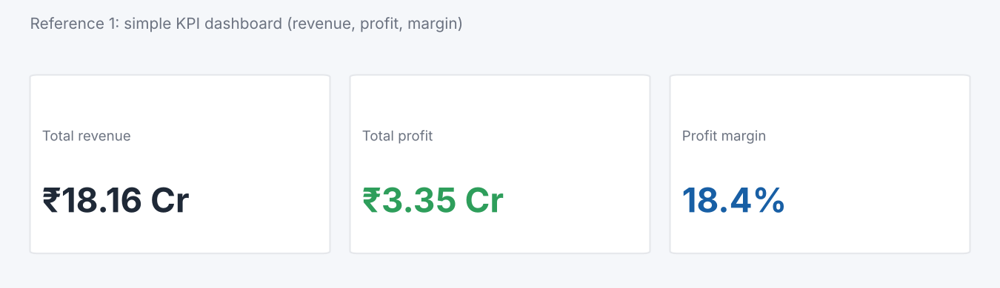
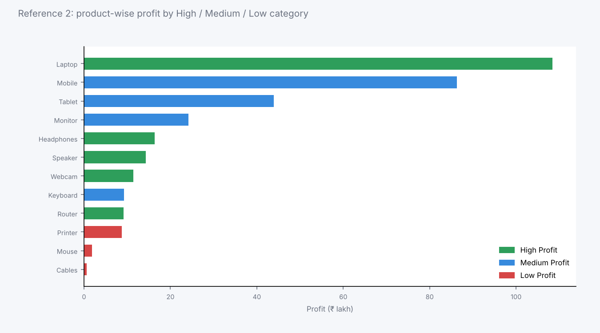
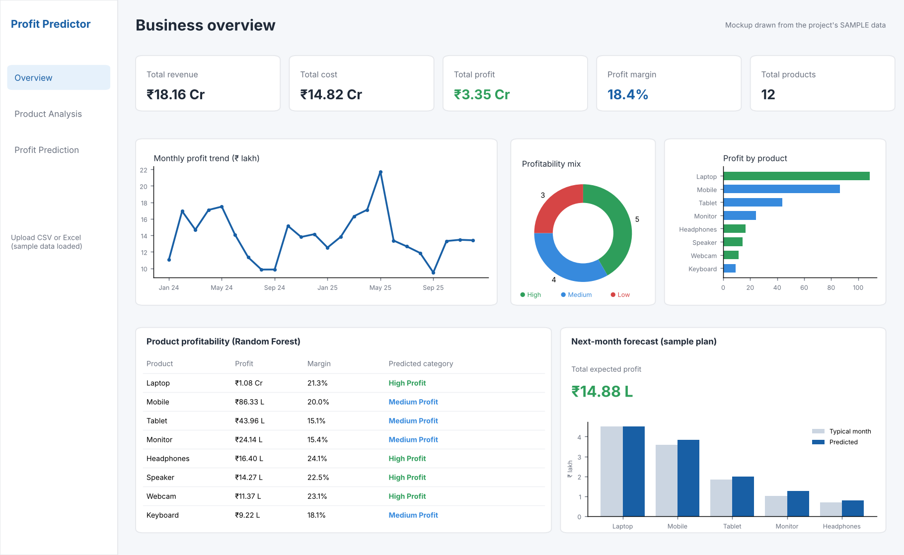

# AI-Based Business Profit Predictor & Analytics Dashboard

A Streamlit dashboard that analyses sales data, classifies products as High / Medium / Low profit
with a Random Forest, predicts profit with Multiple Linear Regression, and forecasts next month's
profit from a planned sales quantity file.

Built only with Python, Pandas, NumPy, Scikit-learn, Streamlit, Plotly and Matplotlib.

## Screenshots of the planned design

| | |
|---|---|
|  |  |



The images are generated by `docs/make_reference_images.py` from the project's sample data.
Image 3 is a mockup of the Overview page; the running app follows the same layout using Streamlit components.

## Run it

```bash
pip install -r requirements.txt
streamlit run app.py
```

The app opens with **sample data** (clearly marked, synthetic). Upload your own CSV or Excel file in the
sidebar to replace it.

## Your data

| Column | Required | Notes |
|---|---|---|
| Product | Yes | e.g. Laptop |
| Quantity | Yes | units sold |
| Selling Price | Yes | per unit |
| Cost Price | Yes | per unit |
| Date | Yes | any common date format |
| Discount | No | 0.10 or 10 both mean 10%; defaults to 0 |
| Profit | No | calculated as (price x (1 - discount) - cost) x quantity if missing |

Common alternative names are recognised (Qty, Price, Unit Cost, Order Date, ...). If a column isn't
recognised, dropdowns in the sidebar let you match it. Rows with missing or invalid key values are
removed and counted in the sidebar. Files can have one row per transaction or one per month: both
models learn from product-per-month totals.

**Next-month plan file:** two columns, `Product` and `Planned Quantity`. A template pre-filled with your
products can be downloaded from the forecast tab. Product names match case-insensitively; names not in
your history are listed and skipped.

## Pages

1. **Overview**: five KPI cards, monthly profit trend, profit by product, High/Medium/Low distribution, and the classification table.
2. **Product Analysis**: search a product to see quantity, revenue, cost, profit, margin, monthly history and predicted category.
3. **Profit Prediction**: three tabs
   - *Single product*: enter price, quantity, cost and discount to get predicted profit, revenue, cost and category.
   - *Next-month forecast*: upload a plan, see profit per product, the total, the top products and a comparison chart. A quick one-product forecast is included.
   - *Model performance*: R², MAE, RMSE, actual-vs-predicted plot, coefficients, classifier accuracy and confusion matrix.

## Machine learning approach

**Profit regression (Multiple Linear Regression).** Inputs: selling price, quantity, cost per unit,
discount and product (one-hot). Target: profit. Revenue and cost are excluded because they are
calculated from the same numbers as profit, which would leak the answer. 80/20 train-test split;
scores are measured on the 20% the model never saw. Forecasts use each product's last three months
for price, cost and discount, with the planned quantity.

**Profitability classification (Random Forest).** Training labels come from the data, not fixed
cut-offs: product margins are ranked and the 33rd and 67th percentiles become the Low/Medium and
Medium/High thresholds. The forest predicts the label from price, cost, discount, quantity and the
cost-to-price ratio. It never receives the margin itself. Product categories are the average of the
forest's probabilities across that product's months, and the table shows the confidence.

Results on the included sample data (your numbers will differ on other data):

| Model | Result |
|---|---|
| Regression | R² 0.934, MAE about 26,200, RMSE about 39,700 (test data) |
| Classifier | 100% on held-out records, 99.3% on products it never saw |

## Limitations (please read before presenting)

- The classifier's high accuracy is partly expected: the cost-to-price ratio is the strongest feature and
  is closely tied to the margin that defines the labels. The model follows the labeling rule; its practical
  value is classifying new price and cost scenarios and giving a confidence score.
- Products near a threshold get low confidence and can differ from the plain margin rule.
- Linear regression approximates profit (price x quantity is not perfectly linear). Expect errors of
  several percent per product. Quantities far outside the history trigger a warning.
- Classification needs at least 3 products, and the profit model needs at least 20 product-month records.
- The train-test split is random. A time-based split is stricter for forecasting.
- Sample data and the sample plan are synthetic and for demonstration only.

## Project structure

```
app.py                      sidebar, upload, column mapping, model training, page routing
preprocessing/data_processor.py   load, validate, clean, monthly aggregation, plan loader
models/regression_model.py        Multiple Linear Regression + evaluation
models/classification_model.py    labeling strategy + Random Forest
analysis/profit_analysis.py       KPIs, product summaries, next-month forecast
visualization/charts.py           Plotly and Matplotlib charts
views/                            overview.py, product_analysis.py, prediction.py
data/                             sample data, sample plan, generator script
tests/test_project.py             automated tests
docs/                             reference images and the script that makes them
.streamlit/config.toml            light theme with blue accent
```

The page folder is called `views` (not `pages`) because Streamlit auto-builds its own menu from a
folder named `pages`, which would duplicate the sidebar navigation.

## Tests

```bash
pip install pytest
python -m pytest tests -q
```

Covers cleaning, bad files, Excel input, transaction-level data, both models, target leakage,
forecasting edge cases, and clicks through every page of the app.
